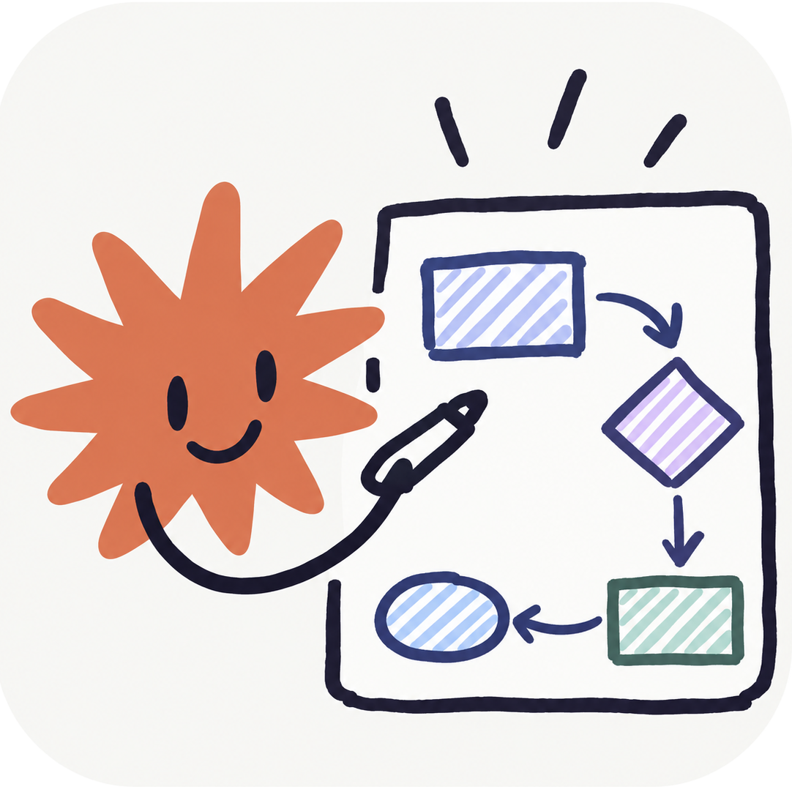

<p align="center"></p>

# claude-excalidraw-diagram

A Claude Code plugin that makes Excalidraw diagrams you can actually open and edit at excalidraw.com. Claude writes a little Python script, the generator turns it into an `.excalidraw` file, and a validator yells about anything broken before you ever see it.

## Why I built this

I wanted Claude to draw me diagrams I could tweak afterward. Mermaid wasn't cutting it, so I had it write Excalidraw files instead. They looked fine in a screenshot. Then I'd drag a box and the whole thing fell apart.

Text wrapped one letter per line. Labels floated next to arrows instead of riding on them. Arrows *looked* attached but weren't, so they stayed behind when the box moved. And anything with a fan-out turned into a hairball.

So I fixed each diagram by hand in the app, had Claude diff my saved file against what it generated, and turned every difference into a rule in the generator and a check in the validator. That loop is baked in now as `/excalidraw-diagram:learn`. Fix one of yours by hand, run it, and the skill picks up your style too.

## The rules

### Make it editable first

If these three are wrong, nothing else matters, cause the diagram breaks the first time someone touches it.

1. **Text goes IN the shape.** The label is bound to the box, so it moves and edits with it. No text box just sitting on top of a rectangle.
2. **Labels go ON the arrow.** Bound to the arrow, so they ride along when it re-routes. You can drag a label along its arrow in the app, too.
3. **Arrows snap to the box.** Both ends get a `fixedPoint` binding on the side they face, about 6 px out, which is exactly what the app writes when you drop an arrow on a shape yourself. My test for this one: align two boxes by their middles, and the arrow between them should go dead level. If it doesn't, it wasn't really snapped.

### Make the arrows flow

- **Ports follow the direction, not the angle.** If the target is to the right, the arrow leaves the right side and comes in the left side, even if the target is way up or way down. Same rule the big layout engines use.
- **Spread the ports out.** When a bunch of arrows share one side of a box, they spread along it, ordered by where they're headed, so they don't cross right at the box. The one going straight across keeps the middle.
- **Every arrow gets its own lane.** I originally had them all merge into one trunk, and you couldn't tell which line went where. Now each one gets its own vertical segment between columns, pinned so the app doesn't reroute it. Claude shuffles the lane order to keep crossings down.
- **Leave room for the lanes.** 120 to 170 px between columns. The generator complains if you squeeze them.
- **Close to level is level.** Anything within 12 px of straight just gets snapped straight.

### Lay it out

- **Kill crossings first.** It's the one thing that's actually been measured to hurt (more below). Put connected boxes near each other in their column.
- **Columns, not coordinates.** One column per stage, same width, same gap. Left to right for a process, top to bottom for a hierarchy.
- **Labels sit by where the arrow starts.** One or two words.

### Text

- **Nunito for everything.** Boxes, labels, titles.
- **Title + notes boxes.** When a box is a name plus some detail, the name is big and the detail sits under it smaller and muted. Way easier to scan than one blob of text. Actual notes and callouts stay one block.
- **Real text widths.** A width of 0 makes excalidraw.com wrap every character onto its own line. Ask me how I know.

### Color means something

Color by role (input, process, the main hub, output, note), keep it to a handful, and never rely on color alone. Dashed means a guess or a note.

## The research

I didn't want this to be just my taste, so I had Claude dig into what's actually been tested. The short version is below, and the full write-up with links is in [`references/layout-rules.md`](skills/excalidraw-diagram/references/layout-rules.md).

- **Crossing lines are the worst thing you can do to a diagram.** Purchase (1997) found crossings were by far the biggest hit to understanding. Bends and symmetry mattered less, and stuff like angles and grid snapping didn't move the needle at all.
- **Next is being able to follow a line with your eye.** Ware and others (2002) found that straight, continuous paths and crossings are the two biggest costs after path length, and they trade off. So don't bend a straight line just to dodge one crossing.
- **The layout engines all pretty much agree.** Graphviz, Eclipse ELK, and dagre all put each stage in a layer, line up connected nodes, pick ports by flow direction, and leave room between layers for labels. I borrowed their defaults and sized them for diagrams a person is going to edit.
- **Flowchart and architecture standards** (ISO 5807, BPMN, C4) say the same boring, correct stuff: one main direction, the happy path on one straight line, one level of detail per diagram, and a label on every line saying what's flowing.
- **Excalidraw's own source code** settled the file details: how bindings get stored, how the elbow router picks a side, how labels sit along a path, and how big the gap behind a label is.

## What the validator checks

`scripts/validate.py` runs after every build. Problems get fixed. Warnings are worth a look.

- Every arrow end is bound both ways, has a `fixedPoint`, and sits on the box edge.
- No text floating over a box unless it's grouped with it, and no text with zero width.
- No arrow running through a box it isn't connected to.
- Arrows that are a few px off level, and which boxes to align to fix it.
- Crossings and arrows lying on top of each other, by name.
- Any font that isn't Nunito.

## Commands

| Command | What it does |
|---|---|
| `/excalidraw-diagram:diagram <description>` | Plans, generates, and validates a new diagram, and keeps the script so you can change it later |
| `/excalidraw-diagram:validate <file>` | Checks bindings, floating text, crossings, shared lanes, and fonts |
| `/excalidraw-diagram:render <file>` | Opens the file in excalidraw.com (Playwright) and looks at a screenshot |
| `/excalidraw-diagram:learn <generated> <hand-fixed>` | Diffs your hand fix against the generated file and teaches the skill your rules |

You don't have to use the commands. The skill kicks in on its own when you ask Claude to diagram or map something.

## Install

```
claude plugin marketplace add elliotboney/claude-excalidraw-diagram
claude plugin install excalidraw-diagram@excalidraw-diagram
```

Or inside Claude Code: `/plugin marketplace add elliotboney/claude-excalidraw-diagram`, then `/plugin install excalidraw-diagram@excalidraw-diagram`.

You'll need Python 3. `render` needs the Playwright MCP server.
